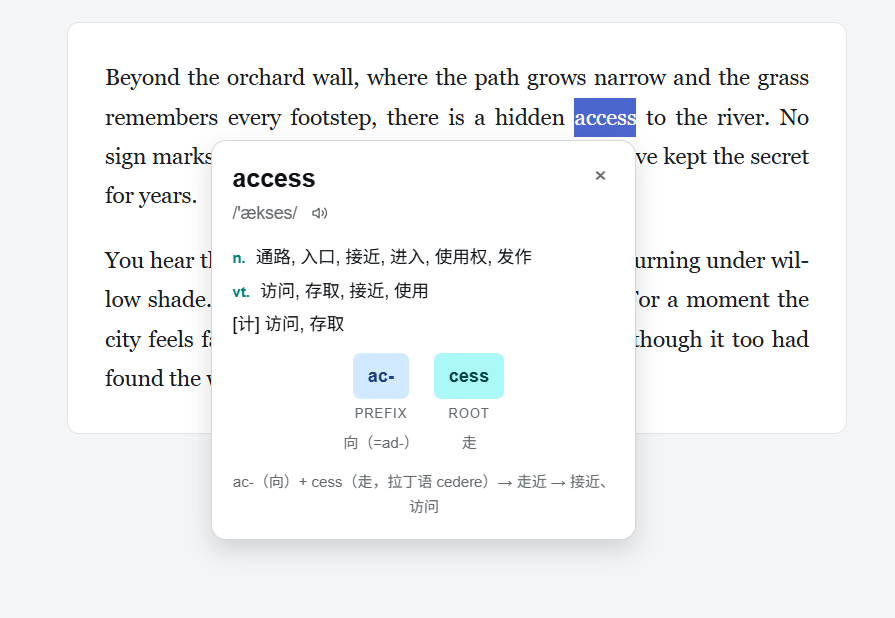
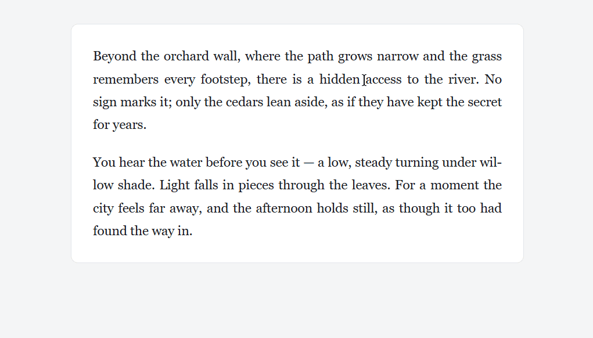
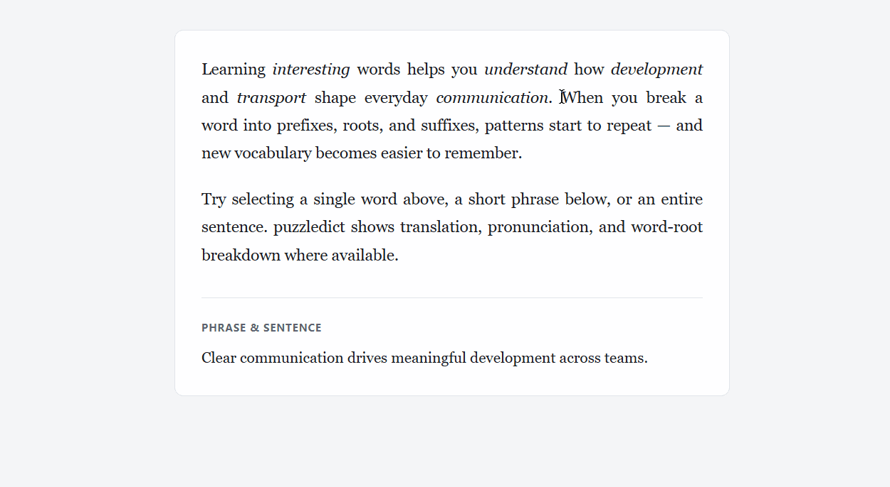
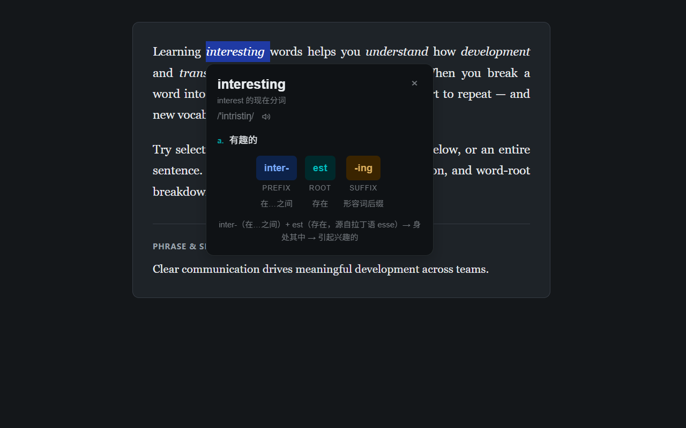
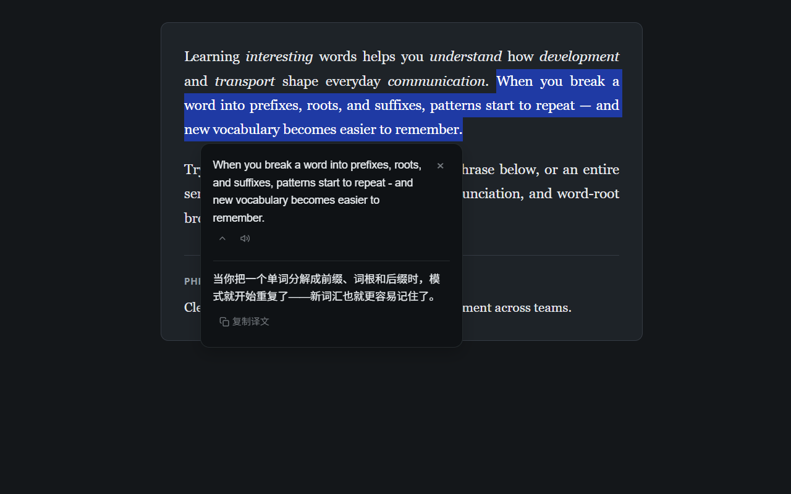

[中文](./README.md) | **English**

# puzzledict

A Chrome extension for translating selected text, with word-root analysis.

## Why I built it?

I usually use selected-text-translate extensions to read English documents, but there is no word-root analysis in common extensions, so I developed this extension.

### What is word-root?

A word can generally be broken down into a root and affixes. For example, transport can be decomposed into the prefix "trans"(across) and the root "port"(to carry). The combination of the prefix and the root forms the word, and the combination of their respective meanings yields the meaning of the word itself - "to take goods or people from one place to another".

Remembering one root, together with its affixes, lets you understand a family of words. For example, import and export share a root with transport:

- import = `im`(into, in) + `port`(to carry) ->
  'bring (goods or services) into a country from abroad for sale.'
- export = `ex`(out, away) + `port`(to carry) -> 'send (goods or services) to another country for sale.'

So learning word-roots can deepen our understanding of English words, and improve English learning efficiency.

## Features

### Dictionary and translate

- 10,000 high-frequency words are built in locally, allowing for instant lookups
- The root database covers more than half of all high-frequency words and is continuously expanding
- Word lookup results display definitions and phonetic symbols, with support for pronunciation
- Translation results support pronunciation and copying
- Both word lookups and translations are cached locally, ensuring rapid response for repeated queries

### Other features

- Totally free
- No login or registration required
- Switches to light or dark mode based on host sites or system preferences

## How to use?

1. Select English words or sentences in web pages
2. Click the puzzledict icon that appears beside selection
3. View the result of word lookup or translation in the popped up panel

### Screenshots

Root breakdown

Lookup word

Translation

Dark mode - lookup word

Dark mode - translation

### Installation

- [Chrome Web Store](https://chromewebstore.google.com/detail/puzzledict/fjnbhpmpglmpaaehjpjajflmhnifjjoi?utm_source=github&utm_medium=referral)
- [Release Page](https://github.com/zhongyangxun/puzzledict/releases)

## Tech stack

- JavaScript + HTML + CSS, no front-end framework
- Rollup: module construction and packaging
- Chrome Extension APIs: service worker, local storage, etc.
- ESLint + Prettier: code linting and formatting
- lint-staged + husky + commitlint: commit-related checks

## Architecture

**Selecting text**

1. Check whether the text is mostly Latin letters.
2. If so, show an icon and send a throttled warmup request.
3. After the user clicks the icon, use the word count to choose a lookup or a translation.

**Lookup**

1. Try the local high-frequency word list, the API cache, the dictionary API, and the translation API, in that order, and stop at the first hit.
2. When the dictionary API or the translation API hits, write the result to that API's cache.
3. Then match the local word-root data.
4. Show the definition, phonetic transcription, a pronunciation button, and the word-root breakdown when one exists.

**Translation**

1. Try the local API cache and then the translation API, and stop at the first hit.
2. When the translation API hits, write the result to the translation API cache.
3. Show the translation, a pronunciation button, and a copy button.

### Server repository

Backend monorepo: [web-services](https://github.com/zhongyangxun/web-services)

- dictionary API package: [dict-api](https://github.com/zhongyangxun/web-services/tree/main/packages/dict-api)
- translation package: [translate-gateway](https://github.com/zhongyangxun/web-services/tree/main/packages/translate-gateway)

## Attribution

- [ECDICT](https://github.com/skywind3000/ECDICT) — local dictionary data and dict-api word database (MIT)
- [Wikipedia: Greek and Latin roots](https://en.wikipedia.org/wiki/List_of_Greek_and_Latin_roots_in_English) — root reference data
- Word root annotations in `word_roots.json` — original to this project

See [THIRD_PARTY_NOTICES.md](./THIRD_PARTY_NOTICES.md) for license texts.

## License

Source code is licensed under the [MIT License](./LICENSE).

Bundled dictionary and word-root data keep their original licenses;
see [THIRD_PARTY_NOTICES.md](./THIRD_PARTY_NOTICES.md).

## Pull Requests

External pull requests are not accepted at this time.
