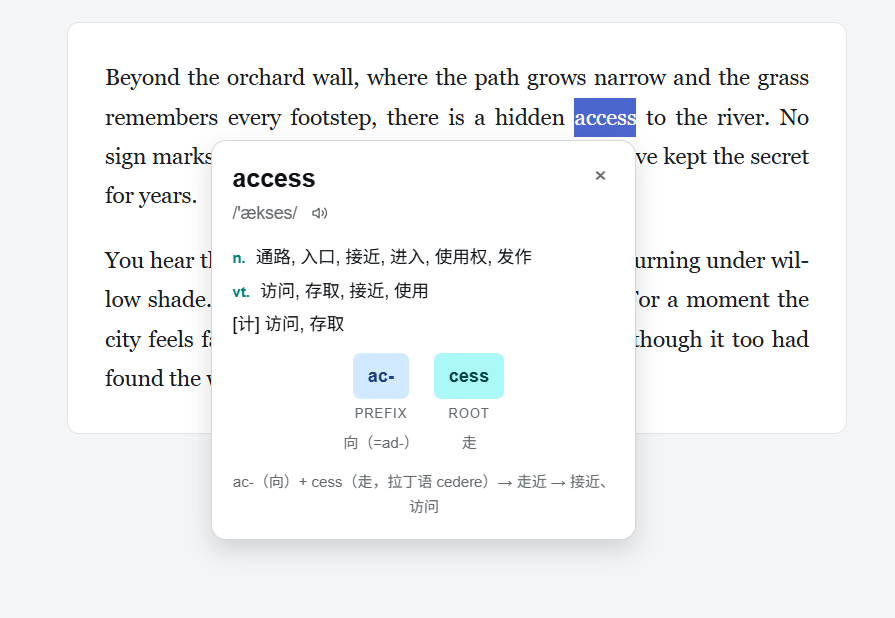
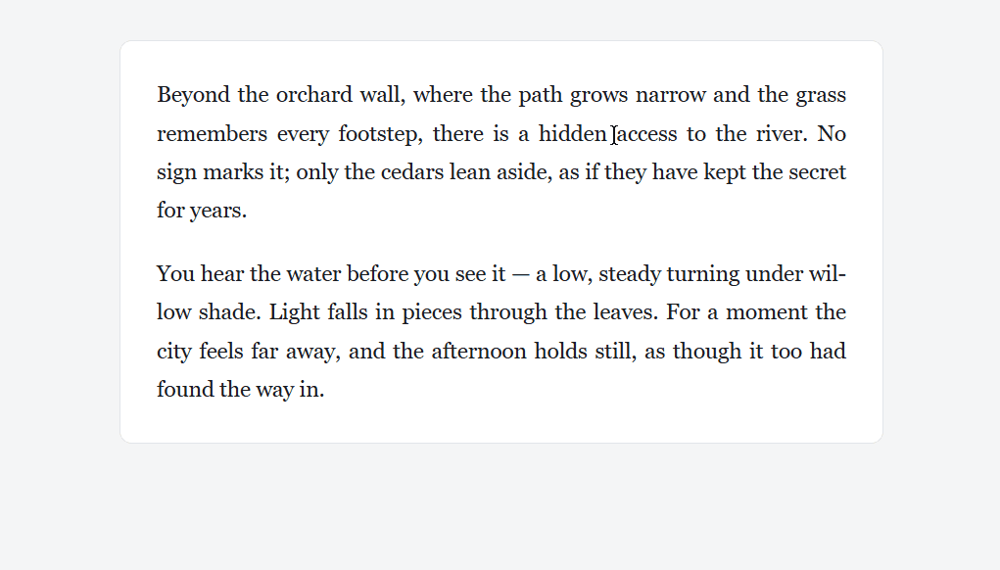
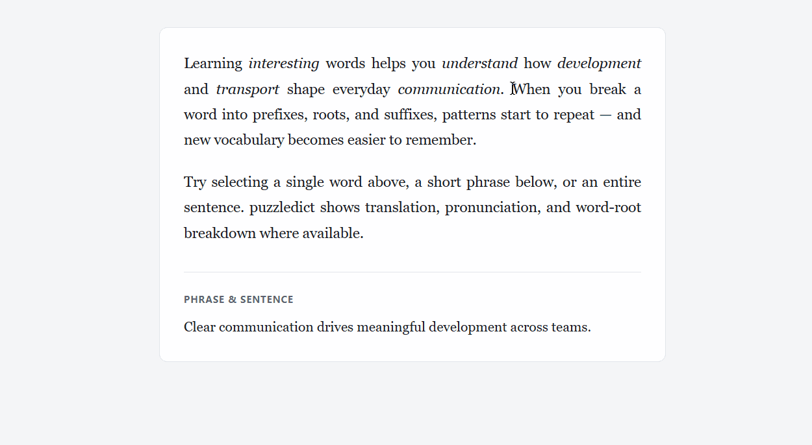
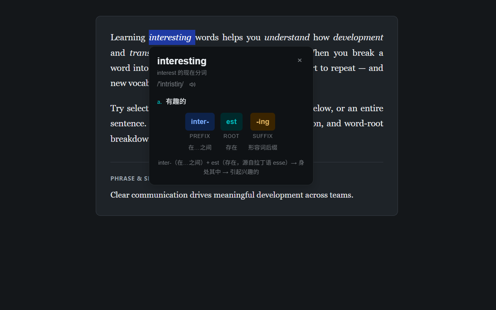
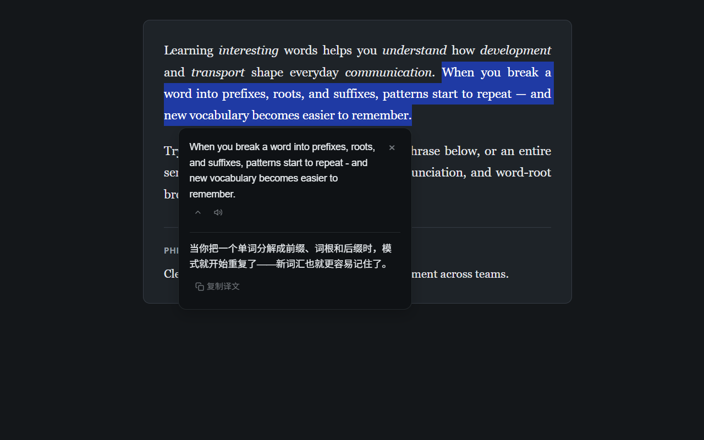

**中文** | [English](./README.en.md)

# puzzledict

支持词根拆解的 Chrome 划词翻译插件。

## 为什么做？

我常用划词翻译插件阅读英文文档，但常见插件都没有词根拆解，于是我做了 puzzledict。

### 词根是什么？

一个单词一般可拆为词根与词缀。例如 transport 可拆解为前缀 trans（跨越） 与 port（搬运）。前缀与词根组成了单词，它们的意义组合也组成了单词的意义——“运输”。

记住一个词根，加上词缀的辅助，就可以理解同根的一系列词汇。例如 import 和 export 是 transport 的同根词，它们可分别这样拆：

- import = `im`（进入）+ `port`（搬运）-> 进口；导入
- export = `ex`（向外）+ `port`（搬运）-> 出口；导出

所以学习词根能够加深我们对单词的理解，提升英语学习效率。

## 功能特点

### 查词与翻译

- 本地内置了 10000 高频词，高频词查询无需等待
- 词根库覆盖半数以上高频词，并在持续扩充中
- 查词结果展示释义、音标，支持发音
- 翻译结果支持发音、复制
- 查词结果与翻译结果皆提供本地缓存，重复查询快速反应

### 其它特性

- 完全免费
- 无需登录或注册
- 界面随浏览器或站点切换浅色或深色模式

## 使用方法

1.  在网页上选中英文单词或句子
2.  点击选区旁出现的 puzzledict 图标
3.  在弹出面板中查看查词或翻译结果

### 使用示例截图

词根拆解

查词

翻译示例

夜间模式 - 查词

夜间模式 - 翻译

### 安装

- [Chrome 商店](https://chromewebstore.google.com/detail/puzzledict/fjnbhpmpglmpaaehjpjajflmhnifjjoi?utm_source=github&utm_medium=referral)
- [发布页](https://github.com/zhongyangxun/puzzledict/releases)

## 技术栈

- JavaScript + HTML + CSS，无前端框架
- Rollup：模块构建与打包
- Chrome Extension APIs：service worker 及本地存储等
- ESLint + Prettier：代码规范检查和格式化
- lint-staged + husky + commitlint：提交相关检查

## 架构

**选中文本**

1. 判断是否以拉丁字母为主。
2. 若是，弹出图标，并发送节流的预热请求。
3. 用户点击图标后，按单词数进入查词或翻译。

**查词**

1. 依次尝试本地高频词库、接口缓存、查词接口、翻译接口，命中即停。
2. 查词接口或翻译接口命中时，写入对应缓存。
3. 再匹配本地词根库。
4. 展示释义、音标、发音按钮，以及词根拆解（若有）。

**翻译**

1. 依次尝试本地接口缓存、翻译接口，命中即停。
2. 翻译接口命中时，写入翻译缓存。
3. 展示译文、发音按钮和复制按钮。

### 服务端仓库

后端 monorepo：[web-services](https://github.com/zhongyangxun/web-services)

- 词典接口子仓：[dict-api](https://github.com/zhongyangxun/web-services/tree/main/packages/dict-api)
- 翻译接口子仓：[translate-gateway](https://github.com/zhongyangxun/web-services/tree/main/packages/translate-gateway)

## 署名

- [ECDICT](https://github.com/skywind3000/ECDICT) — 本地词典数据与 dict-api 词库（MIT）
- [Wikipedia: Greek and Latin roots](https://en.wikipedia.org/wiki/List_of_Greek_and_Latin_roots_in_English) — 词根参考数据
- `word_roots.json` 中的词根标注 — 本项目原创

许可证正文见 [THIRD_PARTY_NOTICES.md](./THIRD_PARTY_NOTICES.md)。

## 许可证

源代码采用 [MIT License](./LICENSE)。

随附的词典与词根数据保留其原有许可证；
见 [THIRD_PARTY_NOTICES.md](./THIRD_PARTY_NOTICES.md)。

## Pull Requests

本项目为个人项目，暂不接受外部 Pull Request。
